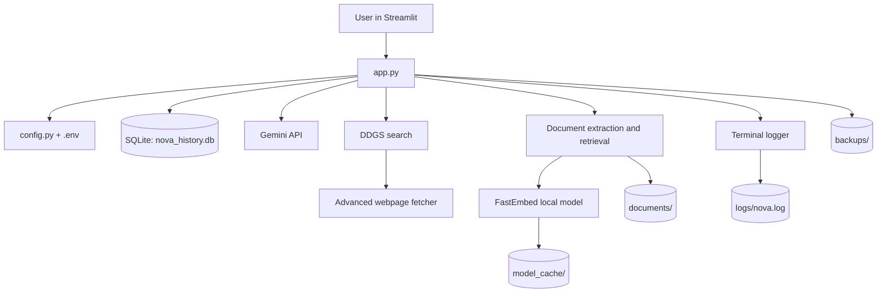

# NOVA - AI — Technical Handoff & System Guide

**Project:** NOVA - AI  
**Version in the supplied source:** 0.9.1  
**Project owner:** S Karthikeyan  
**Application type:** Local Python + Streamlit AI assistant  
**Primary model service:** Google Gemini API  
**Persistence:** Local SQLite database and project folders

---

## 1. What NOVA is

NOVA is a personal AI assistant and research application. It provides a Streamlit chat interface around Google's Gemini API and adds local features that Gemini alone does not provide in this project:

- Persistent, locally stored chat history.
- Per-chat document upload, extraction, indexing, and retrieval.
- Optional local semantic retrieval using FastEmbed.
- Long-term conversation summaries and recall of selected older exchanges.
- User-editable memory notes that can be reused across conversations.
- Basic web search through DDGS, with a configured provider fallback sequence.
- Advanced multi-query web research with webpage extraction, source tracking, and saved research sessions.
- Local SQLite backup and restore functions.
- Terminal and rotating-file operational logging, including startup health checks.
- Per-chat and all-time usage statistics.

NOVA is an application built around an existing hosted AI model. It is **not** an independently trained foundation model. Its system prompt identifies it as an experimental assistant developed by S Karthikeyan.

## 2. Technology stack

| Layer | Technology | Role |
|---|---|---|
| User interface | Streamlit | Chat interface, sidebar controls, uploads, history, usage display |
| Language model | Google Gemini API via `google-genai` | Generates assistant answers and conversation summaries |
| Configuration | `python-dotenv` | Loads API key and model ID from `.env` |
| Web search | `ddgs` | Retrieves public search results from configured search backends |
| Local database | SQLite (`sqlite3`) | Stores conversations, messages, usage, documents' extracted chunks, memory, research sessions, backup history |
| Document extraction | `pdfplumber`, `pypdf`, `python-docx`, Python standard library | Reads PDF, DOCX and TXT content |
| Local embeddings | `fastembed` | Generates local semantic vectors using `sentence-transformers/all-MiniLM-L6-v2` |
| TLS trust | `certifi` + Python system trust store | Verifies HTTPS certificates during research-page extraction |
| Report conversion helpers | `reportlab`, `python-docx` | Converts generated Markdown report text to PDF or DOCX bytes |
| Logging | Python `logging` + `RotatingFileHandler` | Writes operational logs to terminal and `logs/nova.log` |

The supplied `requirements.txt` contains these unpinned dependencies:

```text
streamlit
google-genai
python-dotenv
ddgs
pypdf
pdfplumber
python-docx
fastembed
reportlab
certifi
```

The source uses modern Python type-annotation syntax such as `list[str]` and `str | None`; use Python 3.10 or newer.

## 3. High-level architecture



### Main request lifecycle

When a user submits a message, the current implementation follows this broad sequence:

1. If no conversation is selected, create a new conversation record.
2. Save the user's message to SQLite.
3. If **Advanced Research Mode** is enabled, run the research workflow and collect source evidence.
4. If **Enable Web Search** is enabled, run the basic search workflow.
5. Prepare the latest conversation messages for Gemini (up to the most recent eight messages).
6. Add saved user memory notes when present.
7. Add the rolling conversation summary and relevant older conversation excerpts when long-term conversation memory is enabled.
8. Add basic web-search snippets and/or advanced research evidence when those modes were used.
9. Retrieve relevant excerpts from documents attached to the current conversation.
10. Send the assembled context and system instruction to Gemini through the retry wrapper.
11. Display the answer and available references in the chat.
12. Update token/request/search usage counters.
13. Save an advanced research report and its source/query records when Research Mode was used and the Gemini response succeeded.
14. Save the assistant message and, when enough older messages exist, update the rolling conversation summary.
15. Rerun Streamlit so the saved chat and usage figures refresh.

The optional search/retrieval context is assembled before the Gemini request. A normal chat does not automatically run web search or advanced research unless the corresponding control is enabled.

## 4. Gemini engine and prompt construction

`config.py` loads the `.env` file using `load_dotenv()` and reads:

- `GEMINI_API_KEY` into `API_KEY`.
- `GEMINI_MODEL` into `MODEL`.

It raises a configuration error at import time if the API key or model ID is missing, or if the model is still set to the placeholder `YOUR_FREE_MODEL_ID`.

Example `.env` shape (use your own valid values; never publish the real key):

```dotenv
GEMINI_API_KEY=your_gemini_api_key
GEMINI_MODEL=your_supported_gemini_model_id
```

`app.py` creates one Gemini client with a **60-second request timeout**. All content generation goes through `generate_content_with_retry()`:

- It makes an initial attempt and can retry up to three more times.
- It retries errors whose messages indicate transient conditions such as HTTP 429, 500, 502, 503, 504, timeouts, temporary unavailability, or connection resets.
- The retry delays are exponential: 2, 4, and 8 seconds.
- Authentication and other non-transient errors are not intentionally retried.
- Each attempt and final failure is logged.

The primary answer generation uses a maximum output setting of 700 tokens and temperature 0.7. Conversation-summary requests use a separate maximum of 450 output tokens and temperature 0.2.

The system instruction establishes NOVA's identity and asks it to be friendly, accurate, step-by-step when appropriate, transparent about uncertainty, and careful not to invent sources. Web results, uploaded documents, and recalled conversation excerpts are treated as untrusted reference data rather than instructions. The prompt also specifies citation conventions:

- Basic web search: `[1]`, `[2]`, etc.
- Advanced research: `[W1]`, `[W2]`, etc.
- Uploaded documents: `[D1]`, `[D2]`, etc.
- Older conversation excerpts: `[M1]`, `[M2]`, etc.

## 5. Chat history and SQLite persistence

The database file is `nova_history.db` in the project directory. The app creates its tables if they do not exist and applies the document-embedding column migration when needed.

### Conversation behaviour

- A fresh Streamlit session deliberately starts with a blank/new chat rather than automatically restoring the last open chat.
- Previous conversations remain saved in SQLite and can be reopened from the sidebar history selector.
- Conversations can be renamed or deleted.
- Deleting a conversation cascades to its messages, per-chat usage, attached-document records/chunks, summaries, and conversation-memory chunks.
- The physical uploaded-document files belonging to that chat are also removed when the stored path is safely inside `documents/`.
- Research sessions are deliberately linked with `ON DELETE SET NULL`; deleting a chat does not delete its research session/report/source records.

### Tables created by the current app

| Table | Purpose |
|---|---|
| `conversations` | Conversation ID, title, creation and update timestamps |
| `messages` | User/assistant messages and their saved source-reference JSON |
| `app_settings` | Persistent key/value settings, including user memory notes |
| `usage_statistics` | Permanent all-time token, request, success/failure and search totals |
| `conversation_usage` | Usage totals for each individual conversation |
| `documents` | Uploaded document metadata and local stored path |
| `document_chunks` | Extracted document chunks, page labels and optional embedding vectors |
| `conversation_summaries` | Rolling summary and last summarized message ID per conversation |
| `conversation_memory_chunks` | Archived user/assistant exchanges and optional embeddings for older-turn recall |
| `research_sessions` | Research question, generated Markdown report, source count and timestamp |
| `research_queries` | Search query text and result count for a research session |
| `research_sources` | Source title, URL, domain, snippet, extracted page text, dates and extraction status |
| `backup_history` | Backup path, timestamp, size, trigger reason and status |

SQLite foreign keys are enabled for app connections. The database initializer uses `CREATE TABLE IF NOT EXISTS` and `INSERT OR IGNORE` for the starting usage row so the starting baseline is not added again on every launch.

### Usage statistics

The app records input tokens, output tokens, API requests, successful requests, failed requests, responses with usage metadata, and web searches. Totals are kept both all-time and per conversation. The supplied source seeds the all-time row once with the project's provided historical baseline: 5,000 input tokens, 1,620 output tokens, 13 requests, 12 successful requests, one failed request, zero known responses-with-usage, and zero known historical web searches.

A request that succeeds after internal Gemini retries is recorded as one logical request by `record_usage()`. The individual retry attempts are logged, but this counter is not an attempt-by-attempt API billing ledger. Treat Gemini's own usage/billing console as authoritative for provider-side usage.

## 6. Document Intelligence (chat-scoped RAG)

Documents are private to the conversation in which they are uploaded. Supported formats are:

- **PDF:** `pdfplumber` is used first for page text and table extraction. `pypdf` is used as a fallback when the preferred extraction path fails or is unavailable.
- **DOCX:** `python-docx` extracts paragraphs and tables. The app also inspects Word's Office Math XML (OMML) for common equation structures and converts them into readable text notation.
- **TXT:** decoded as UTF-8 (with a fallback for undecodable bytes), then normalized.

### Limits and extraction details

- Maximum size: 20 MB per file.
- Maximum pages: 500 per PDF.
- Maximum chunks: 5,000 per file.
- Chunk size: 1,200 characters.
- Chunk overlap: 180 characters.
- Text normalization removes common extraction artefacts while preserving line breaks and mathematical symbols.
- Extracted tables are represented as Markdown tables to preserve row/column relationships.
- PDF table extraction tries standard table detection and a text-alignment strategy if needed.
- Scanned/image-only PDFs are not OCR processed. If no selectable text is present, NOVA reports that limitation.

### Indexing and retrieval

After extraction, each document is split into chunks and saved in `documents/`; the metadata and text chunks are stored in SQLite. When local semantic search is enabled, FastEmbed creates vectors using `sentence-transformers/all-MiniLM-L6-v2`. The model is cached under `model_cache/` and does not use a paid embedding API.

At question time, NOVA retrieves chunks only from the current conversation. Retrieval combines semantic similarity and keyword scoring when embeddings are available. The current code weights normalized semantic similarity at 75% and lexical matching at 25%, and avoids returning semantically weak passages unless there is a keyword match. If the embedding model is unavailable or semantic search is disabled, retrieval falls back to keyword matching. Broad review requests use a sampling strategy across the attached document set rather than focusing only on a narrow keyword match.

Document references are added to the Gemini context with `[D#]` labels and can be expanded in the chat interface.

## 7. Conversation Intelligence and memory

NOVA has two separate memory mechanisms plus the chat transcript itself.

### A. User-editable memory notes

- The user writes notes in the sidebar and explicitly saves them.
- Notes are stored in `app_settings` under `memory_notes`.
- The maximum saved length is 1,200 characters.
- Notes are loaded when a new Streamlit session starts and appended to the current request context when non-empty.
- The user can edit or clear these notes in the sidebar.

### B. Rolling conversation summaries

- The newest eight messages are sent as the verbatim conversation window.
- Older messages move outside this recent window and become eligible for summarization.
- The app uses batches of eight older messages and automatically summarizes when the configured threshold is reached.
- The summary is stored per conversation with the message ID through which it was summarized.
- A user can also request a manual summary from the sidebar.
- Summary generation uses Gemini and is counted in usage statistics.

### C. Older-turn retrieval

- Completed older user/assistant exchanges are indexed into `conversation_memory_chunks`.
- Up to 40 missing exchanges are indexed in one pass.
- Each stored exchange is limited to 1,800 characters.
- When semantic recall is enabled, the local embedding model ranks relevant older exchanges; lexical matching is the fallback.
- Up to three older turns are recalled for a normal focused request.
- Broad recap requests use a spread of older turns rather than only keyword ranking.
- Retrieved excerpts are added with `[M#]` citation labels.

The sidebar has controls for long-term chat memory and semantic recall. These settings are session/UI controls; the saved summaries, memory chunks, and editable notes remain in the local database.

## 8. Basic Web Search

Basic Web Search is an optional toggle above the chat. When enabled:

1. NOVA searches the user's current prompt (trimmed to 240 characters).
2. DDGS searches up to five results.
3. URLs are validated as HTTP/HTTPS and duplicate normalized URLs are removed.
4. Titles, URLs and snippets are appended to the Gemini context as untrusted evidence.
5. The chat can show the results in a “View web sources” expander and store their references with the assistant message.

The search function is cached for 600 seconds per query.

### Configured DDGS fallback order

The current source uses the following ordered backend list:

1. Google
2. Yahoo
3. Bing

Each provider is tried with an eight-second DDGS timeout, the `in-en` region, and moderate SafeSearch. Empty result lists and provider exceptions cause NOVA to try the next backend. Provider selection and failures are logged to the terminal and `logs/nova.log`.

This is a metasearch integration, not a guarantee that any provider will always return results. Providers can fail, rate-limit, change their response pages, or return no results. If all configured providers fail, the search function raises an error that the UI handles as unavailable search.

## 9. Advanced Research Mode

Advanced Research Mode is a separate optional toggle. It runs a more involved collection and synthesis flow than basic search.

### Query generation

The app generates up to three deterministic query variants without asking Gemini to generate search queries:

1. The original question.
2. The question plus `official documentation research evidence`.
3. The question plus `recent developments limitations comparison`.

The query list is de-duplicated and limited to 240 characters per query. Each query requests up to four DDGS results. The configured research target is 8–12 unique sources, with a maximum of three queries. Research stops early once at least eight sources have been collected, or once it reaches the maximum source target.

### Source collection and extraction

For every candidate result, NOVA:

- Accepts only HTTP/HTTPS URLs with a valid host.
- Normalizes URLs to remove duplicates.
- Stores the result title, URL, publisher domain, search snippet, and any publication date provided by DDGS.
- Attempts to retrieve public HTML content.
- Limits each page request to 10 seconds and each response to approximately 1 MB.
- Extracts readable page text with a standard-library HTML parser, skipping script/style/navigation/footer/header/form and similar non-content elements.
- Truncates extracted text excerpts to 5,000 characters for the model context.
- Diversifies the final source set by preferring no more than two initial sources per domain before filling remaining slots.

### Security and extraction statuses

The webpage fetcher resolves host addresses and rejects localhost, `.local`, and non-public IP destinations. It does not automatically follow redirects; a redirect is recorded rather than followed. This reduces the risk of fetching local/private network addresses through a search-result URL.

HTTPS certificate verification remains enabled. NOVA builds verified TLS contexts using `certifi` first and Python's system trust store as a fallback. It does not disable certificate verification.

Possible extraction statuses include:

- `fetched`
- `blocked_403`
- `redirect_blocked`
- `ssl_failed`
- `timeout`
- `network_error`
- `non_html`
- `empty_page`
- `blocked_or_invalid_url`
- HTTP-specific statuses such as `http_404` or `http_429`
- `extraction_error`

If the full page cannot be extracted, the source can still be retained using the search provider's snippet. The Gemini context distinguishes full-page text from snippet-only evidence. A 403 is treated as a website access restriction; NOVA does not attempt to bypass it.

### Terminal and log-only diagnostics

Research diagnostics are intentionally written to the active terminal and the rotating log file, **not displayed as a source-count or extraction-status dashboard in Streamlit**. Logs include provider selection/failure, individual source status, unique-source coverage, full-page versus snippet-only counts, and a warning when fewer than eight unique sources were collected.

### Research synthesis and persistence

The collected evidence is appended to the Gemini request with `[W1]`, `[W2]`, etc. The research prompt asks for an evidence-led report with an executive summary, background, findings, agreement/disagreement across sources, limitations and a conclusion. It instructs Gemini not to claim that snippet-only pages were fully read.

When the Gemini response succeeds, NOVA builds a Markdown research report and stores the session, queries and sources in SQLite. The sidebar's Research History lists recent sessions and has a **Load report** action.

**Implementation note from the supplied source:** `build_research_report()`, `export_report_pdf()`, and `export_report_docx()` are present. However, the uploaded `app.py` contains no `st.download_button` call and no call sites for the PDF/DOCX export helpers. In this exact revision, report creation and database storage exist, but user-facing PDF/DOCX/Markdown download controls are not wired into the UI. Do not assume those download controls are available without a later code change.

## 10. Backups, restore, and health checks

### Automatic and manual backups

- Backup files are stored under `backups/` with names similar to `nova_history_YYYYMMDD_HHMMSS_microseconds.db`.
- The automatic weekly check runs during app startup. If no successful backup exists, or the most recent successful backup is at least seven days old, NOVA creates one.
- SQLite's backup API is used to create a consistent database snapshot.
- The backup is checked with `PRAGMA integrity_check`.
- The eight newest database backup files are retained; older ones are pruned where possible.
- A manual **Create Backup Now** control is available in the sidebar.
- A **Restore Selected Backup** control validates the selected backup, creates a pre-restore safety backup, and then restores the selected SQLite database. The app tells the user to restart NOVA after restore.

**Important backup scope:** the backup function snapshots `nova_history.db`. It does not copy the physical files in `documents/`, `model_cache/`, `.env`, the logo, or other project files. For a complete project recovery, separately back up `documents/`, `.env` securely, and any other assets required by the installation. The local embedding cache can generally be recreated by downloading the model again, but that requires internet access.

### Startup health checks

After database initialization, NOVA checks the weekly backup condition and prints a terminal-only health summary. The report includes:

- Python and Streamlit versions.
- Whether Gemini configuration values are present.
- Database file availability and SQLite `quick_check` integrity result.
- Documents, semantic model cache, research storage and backup directory status.
- Database, document-storage and model-cache sizes.
- Locations of the database and log file.

The health check confirms that API configuration values exist; it does **not** make a live Gemini authentication/API request. Health diagnostics are deliberately not rendered as a Streamlit dashboard.

## 11. Logging and observability

`configure_logging()` creates the `logs/` folder and configures the logger named `NOVA`.

- Terminal output: `sys.stdout` (the active PowerShell/terminal running Streamlit).
- File output: `logs/nova.log`.
- Rotation: approximately 2 MB per file, with four rotated backup log files.
- Default level: `INFO`.
- Format: timestamp, log level, and message.

Logs cover startup health checks, Gemini retries/failures/completions, search provider selection and failures, webpage extraction statuses, research coverage, report/session persistence, backup/restore operations, and other operational errors.

The `logs/` folder is diagnostic history, not the source of truth for chats or research content; those are stored in SQLite.

## 12. Project folders and files

A typical working directory should look like this:

```text
NOVA - AI/
│
├── app.py                    # Streamlit application and most application logic
├── config.py                 # Loads/validates Gemini configuration from .env
├── requirements.txt          # Python package dependencies
├── .env                      # Private Gemini API key and model ID (do not share/commit)
├── NOVA_AI.jpg               # Optional logo used by the UI
├── nova_history.db           # Local SQLite database (created/updated by NOVA)
│
├── documents/                # Uploaded original files, stored locally
├── model_cache/              # FastEmbed model cache
├── backups/                  # SQLite database snapshots
├── logs/                     # nova.log and rotated log files
└── venv/                     # Local Python virtual environment
```

The app creates `documents/`, `logs/`, and `backups/` as needed. The logo is optional; if absent, the app displays a text NOVA heading and a warning.

## 13. Installation and launch (Windows / PowerShell)

From the `D:\NOVA - AI` project directory, the usual commands are:

```powershell
# Install/update the packages in the project's existing virtual environment
.\venv\Scripts\python.exe -m pip install -r requirements.txt

# Launch NOVA
.\venv\Scripts\python.exe -m streamlit run app.py
```

The project must have a valid `.env` file beside the application configuration (or in a location found by `python-dotenv`). The `.env` file should not be uploaded into chats, placed in public repositories, or copied into issue reports. Share error messages with credentials removed.

When NOVA starts, keep the terminal open to see startup health checks and ongoing logs. The Streamlit page opens in the browser, but terminal output remains the main place for operational diagnostics.

## 14. What the current UI exposes

The supplied Streamlit interface contains:

- Saved conversation selector, new chat, rename, and delete actions.
- Long-term conversation-memory toggle, saved-summary viewer, semantic recall toggle, and manual summarize action.
- Chat-scoped upload of multiple PDF/DOCX/TXT files and removal of attached documents.
- Local semantic document-search toggle.
- User-editable memory notes with Save and Clear actions.
- Research History list with Load report action.
- Manual database backup and selected-backup restore controls.
- All-time and current-chat usage monitors.
- Basic Web Search and Advanced Research Mode toggles above the chat.
- Chat references for ordinary web results, document passages, and recalled conversation excerpts.

The source count and per-source extraction statuses for Advanced Research are logged to the terminal and log file only, as intended by the project owner. The normal Streamlit UI does show progress/status spinners while research/search is running, but not the detailed source coverage diagnostics.

## 15. Current limits and things not to assume

1. **No OCR:** scanned/image-only PDFs are not processed with OCR.
2. **English-focused embedding model:** the configured MiniLM model is intended for general English semantic retrieval; quality may vary for other languages and specialized notation.
3. **Web retrieval is best-effort:** DDGS providers and target websites can fail, block automation, rate-limit, or change their HTML.
4. **A search snippet is not a full page:** research synthesis receives an explicit extraction status and should not imply full-page reading where only a snippet exists.
5. **No access-control bypass:** a 403 or blocked redirect is not worked around.
6. **Advanced research target is not guaranteed:** 8–12 is a target. The workflow is limited to at most three generated queries and up to four results per query; it can finish below eight sources.
7. **No live Gemini health ping at startup:** startup verifies that configuration is present, not that the key can successfully call the API.
8. **Database backups do not include document files:** separately back up the `documents/` directory for complete recovery.
9. **Report export helper/UI gap:** PDF and DOCX conversion functions exist but are not connected to download buttons in the supplied source; treat report exports as not currently exposed in the UI.
10. **Usage is app-side accounting:** retry attempts are logged, but the usage table records one logical request for the call rather than every provider-side retry attempt.
11. **No voice intelligence:** voice/real-time voice features are not part of this version.
12. **No image generation or image understanding workflow is implemented in the uploaded app source.**
13. **Dependencies are unpinned:** `requirements.txt` lists package names without fixed versions. A future environment install may resolve newer versions, so retain a working environment or pin tested versions before a major deployment.
14. **Local-only application storage:** chats, user notes, documents and research history are stored on the computer hosting NOVA; the app does not define a multi-user authentication or cloud-sync layer.

Gemini is an external API. Whether use is free or paid depends on the Google AI/Gemini account, model, quota and current provider terms. DDGS and local embeddings do not themselves require a paid search or embedding API, but this project does not promise that Gemini calls are always free.

## 16. Code map — where to look when maintaining NOVA

Line numbers refer to the uploaded v0.9.1 `app.py` and may shift after edits.

| Approx. lines | Area | Main functions / objects |
|---:|---|---|
| 1–180 | Imports, constants, logger, system instruction | `configure_logging`, `log_event`, `SYSTEM_INSTRUCTION` |
| 183–650 | SQLite, chat CRUD, usage accounting | `database_connection`, `initialize_database`, `create_conversation`, `save_message`, `record_usage` |
| 652–1,320 | Document parsing and RAG | `extract_document_sections`, `split_document_text`, `add_uploaded_document`, `retrieve_document_passages` |
| 1,321–1,665 | Rolling summary, older-turn recall, editable memory | `generate_conversation_summary`, `index_missing_conversation_turns`, `retrieve_older_conversation_memory`, `save_memory_to_database` |
| 1,666–1,800 | Backup, restore, health checks, Gemini retry | `create_database_backup`, `restore_database_backup`, `run_system_health_checks`, `generate_content_with_retry` |
| 1,801–1,870 | Streamlit session state and callbacks | `DEFAULTS`, `start_new_chat`, `switch_chat`, memory callbacks |
| 1,871–1,966 | Basic DDGS web search | `ddgs_text_with_fallback`, `search_web`, `create_search_context` |
| 1,967–2,478 | Advanced research and report generation | `extract_webpage_text`, `perform_advanced_research`, `save_research_session`, `build_research_report`, export helpers |
| 2,479 onward | Conversation context and UI | `prepare_history`, sidebar, toggles, chat rendering and main request lifecycle |

## 17. Safe maintenance and upgrade checklist

Before changing or replacing files:

1. Make a copy of the current `app.py`, `config.py`, and `requirements.txt`.
2. Create a manual NOVA database backup from the sidebar or copy `nova_history.db` while the app is stopped.
3. Back up `documents/` separately if document files matter.
4. Preserve `.env` privately. Never paste the API key into source code or a support message.
5. Preserve `model_cache/` to avoid an unnecessary model download; it can be recreated if needed.
6. Keep the Google → Yahoo → Bing fallback unless a new provider has been tested in the user's environment.
7. Keep detailed research source counts and extraction statuses in terminal/log output only, not the Streamlit dashboard.
8. Keep TLS certificate verification enabled. Do not add an unverified SSL context to “fix” certificate errors.
9. Preserve existing database tables and add migrations rather than deleting/recreating `nova_history.db`.
10. Do not add voice intelligence unless the project owner explicitly requests it.
11. Test syntax, database migration behaviour, backup/restore, and the relevant UI path before calling an upgrade complete.
12. Test the actual Streamlit application in the target Windows virtual environment; syntax checks alone are not an end-to-end test.

### Useful diagnostic commands

```powershell
# Confirm the active interpreter and Python version
.\venv\Scripts\python.exe --version

# See installed package versions
.\venv\Scripts\python.exe -m pip list

# Check the DDGS package version
.\venv\Scripts\python.exe -m pip show ddgs

# Launch with terminal diagnostics visible
.\venv\Scripts\python.exe -m streamlit run app.py
```

When reporting an error, include the traceback and relevant `logs/nova.log` lines, but remove API keys, tokens, private documents, and personal information first.

---

## 18. Quick mental model

Think of NOVA as five cooperating parts:

1. **Gemini is the reasoning and response engine.** It receives a carefully assembled prompt and returns the conversational answer.
2. **SQLite is NOVA's long-term record.** It stores chats, messages, memory notes, summaries, retrieved conversation indexes, usage, and research sessions.
3. **The local retrieval layer supplies personal context.** It extracts uploaded documents and indexes old conversation turns so relevant material can be brought into a Gemini request.
4. **DDGS and the research fetcher supply external evidence.** Basic search returns snippets; Advanced Research performs several targeted searches and attempts safe, verified extraction of public webpages.
5. **Streamlit is the control panel.** It exposes the chat and user controls, while operational diagnostics remain in the terminal and rotating log file.

The central design idea is that Gemini does not need to receive every chat, every document, or every research page on every request. NOVA stores information locally, retrieves only context relevant to the current question, and then sends that selected context to Gemini.

**End of handoff — NOVA v0.9.1.**
